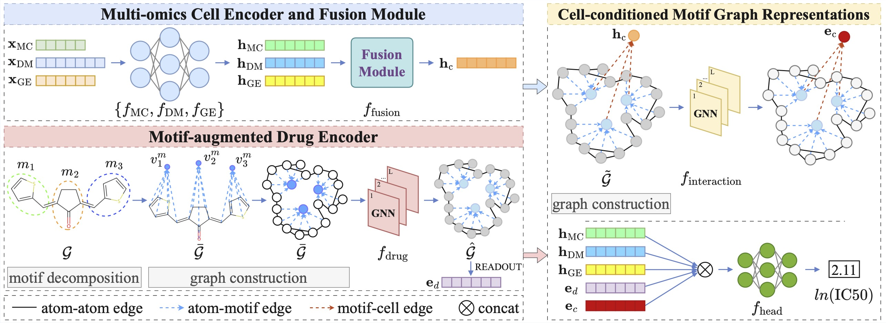

# CCMG: Cell-Conditioned Motif Graphs for Drug Response Prediction

This repository provides the official implementation of **“Interpretable multi-omics learning with cell-conditioned motif graphs for drug response prediction”**, published in *Applied Soft Computing*.



Cell-Conditioned Motif Graph (CCMG) is a graph-based framework for accurate and interpretable drug response prediction. It explicitly models interactions between molecular motifs and the multi-omics context of individual cell lines.

CCMG augments molecular graphs with motif-level representations and integrates cell-specific multi-omics embeddings within a unified graph structure. This enables the model to learn how molecular substructures relate to drug response in different cellular contexts, while supporting interpretation at the atom, motif, and gene levels.

## Installation

The datasets in this repository are stored using [Git Large File Storage (LFS)](https://git-lfs.com/). Install Git LFS before cloning. On Ubuntu, run:

```bash
sudo apt-get install git-lfs
```

Then initialize Git LFS and clone the repository:

```bash
git lfs install
git clone https://github.com/ndlongvn/CCMG.git
cd CCMG
git lfs pull
```

If files under `data/` contain text beginning with `version https://git-lfs.github.com/spec/v1`, they are LFS pointers. Run `git lfs pull` to download the actual data.

We recommend using a dedicated Python 3.10 environment. After activating it, install the required dependencies:

```bash
python -m pip install -r requirements.txt
```


## Input data

The input data are stored in `data/GDSC/data_processed/` and were prepared by further preprocessing the data provided by [TransCDR](https://link.springer.com/article/10.1186/s12915-024-02023-8).

To use a different input directory with the same file names and schema, pass `--data_dir /path/to/data_processed` when running the training script.

## Training

To run ten-fold cross-validation with the GIN encoder and all three omics modalities, use:

```bash
python training_regression.py
```

Three data-splitting protocols are available through `--split_type`:

- `discovery` (default): splits individual drug–cell response pairs, allowing drugs and cell lines to appear in multiple partitions.
- `blind_cell`: partitions the data by cell line, keeping cell lines separate across training, validation, and test sets.
- `blind_scaffold`: partitions the data by Bemis–Murcko scaffold, keeping scaffold groups separate across training, validation, and test sets.

For a full list of training options, run `python training_regression.py --help`.

## Acknowledgements

This repository builds upon the following projects:

- [TransCDR](https://github.com/XiaoqiongXia/TransCDR)
- [HiMol](https://github.com/ZangXuan/HiMol)

We thank their authors and contributors for making their code and resources publicly available.

## Citation

If you use CCMG in your research, please cite:

```bibtex
@article{Nguyen2027,
  title = {Interpretable multi-omics learning with cell-conditioned motif graphs for drug response prediction},
  volume = {204},
  ISSN = {1568-4946},
  url = {http://dx.doi.org/10.1016/j.asoc.2026.116599},
  DOI = {10.1016/j.asoc.2026.116599},
  journal = {Applied Soft Computing},
  publisher = {Elsevier BV},
  author = {Nguyen,  Long D. and Ho,  Luong and Nguyen,  Nhat M.T. and Pham,  Hoang C. and Teesdale-Spittle,  Paul H. and Nguyen,  Binh P.},
  year = {2027},
  month = Jan,
  pages = {116599}
}
```
